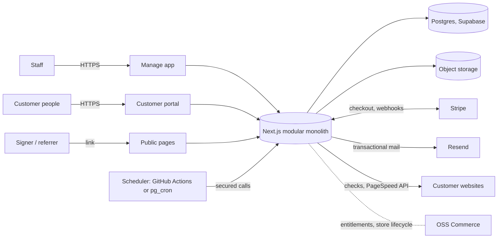
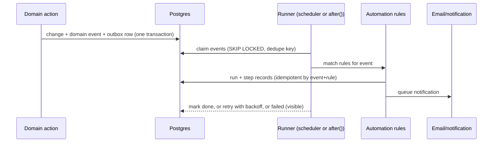
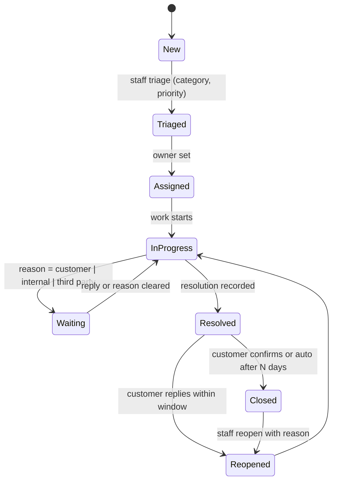
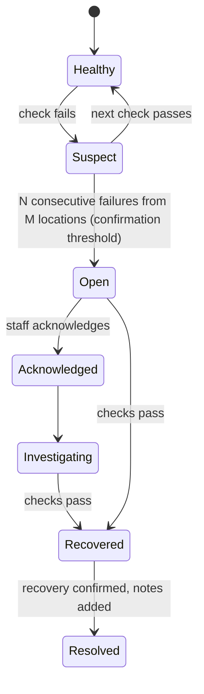

# OneSimpleSite Management: reconstruction plan, specification and progress record

Companion to `docs/ARCHITECTURE.md` (how the platform works today). This file is what we are building toward, why, in what order, and how far we have got. It is kept up to date as work lands; every claim of "done" has to be backed by the verification rules in section 9.

**Ground rules (from the owner):** the platform's purpose does not change (it manages the business and is used by clients). The live system is a properly built foundation: keep working business logic, security guarantees, financial evidence and customer records; replace weak implementation. All work happens on **dev** (`manage.dev` / `portal.dev.onesimplesite.co.uk`, separate Supabase). Live changes only by explicit approval: additive migrations, then the owner presses Redeploy.

---

## 1. Status at a glance

| Area | State |
|---|---|
| Dev environment, separate DB, auto-deploy, logins, health, smoke | Done and verified |
| Test suites runnable against dev (14 suites, dev hooks) | Done; 13 of 14 pass on dev, page crawl in progress |
| Architecture document of the current system | Done (`ARCHITECTURE.md`) |
| Design system adopted from OSS Commerce | **Specified below; implementation starting (Phase 1)** |
| Mobile composition (no sticky top bar on phones) | Phase 1 |
| Cross-cutting primitives (activity, approvals, events, inbox, files, service register) | Phase 2 |
| Domains: cases, changes, projects, websites, monitoring, referrals, reports, automations | Phases 3 to 8 |

---

## 2. Audit: what the current system gets right, and where it is weak

Verified against the repository (not just the earlier document).

**Keep (do not recreate):**
- Quote, signing and evidence engine: frozen sent text and terms, append-only signature and audit tables enforced by database triggers, sealed PDFs.
- Outbox pattern with atomic claim (`FOR UPDATE SKIP LOCKED`), dedupe keys, retries.
- Stripe webhook verification and idempotency; receipts as the only measure of money in.
- Capability-based staff permissions and customer isolation by company; least-privilege database role; row-level security.
- References allocated atomically; vault encryption; erasure function; plain-language wording.

**Weak or missing (to rebuild or add):**
1. **Visual system is two unrelated themes** (team: monochrome; portal: green and pastels) and a sticky top bar on every page, including phones.
2. **No single activity history.** Audit events, ticket comments, project updates and notes are separate stores; there is no per-company timeline.
3. **Support is one flat ticket model** with a six-value status; no triage, queues, SLA clock, satisfaction, reopen rules, or waiting reasons.
4. **Change requests are a ticket category** with a price field, not a process (no scope record, quote versions, expiry, amend, or "what was asked vs agreed").
5. **No approval engine**: approvals are special cases in signing and change pricing.
6. **Project stage changes carry financial side effects** (launch starts the plan; ready-to-launch requests payment) without explicit precondition checks or a visible "what will happen".
7. **No service register**: websites, domains, hosting, care plans and commerce stores are not modelled as assets, so monitoring, renewals and incidents have nothing to attach to.
8. **No monitoring, no referrals, no reporting, no automations, no in-app notifications.**
9. **Files stored in the database** under the host's 4.5 MB request limit.
10. **Charge wording is formatted in several places**, so one change can leave a screen behind.
11. **A thrown "forbidden" renders as a 500** on some pages (fixed for Projects; audit the rest).
12. **Scheduling is limited**: Vercel Hobby allows one cron run per day.

---

## 3. Design system: OSS Commerce, extracted from its source

Source of truth: `AbuFitz/osscommerce`, `apps/portal/src/app/globals.css`, `packages/ui/src/ui.css`, and `docs/design/portal-interaction-principles.md`. We adopt the same visual family, adapted to agency operations.

**Typeface:** Geist (sans) and Geist Mono (`geist` package). Tabular numerals on by default.

**Tokens**

| Token | Value | Use |
|---|---|---|
| `--ink` / `--ink-2` / `--muted` / `--faint` | `#14170f` / `#3a4030` / `#565c4a` / `#9aa08c` | Text |
| `--olive-950 … 300` | `#161d0b #232f10 #33441a #4a6024 #7d9a3f #b9d072` | Rail, primary buttons, emphasis |
| `--lime` / `--lime-2` | `#d6e8a7` / `#e8f2c8` | Active state, highlights, accents |
| `--sand` / `--paper` | `#f3f1e8` / `#fbfbf7` | Neutral surfaces |
| `--blue` `--lilac` `--peach` | `#dbe9f7 #e4dcfa #f6e3d1` | Tonal widget fills |
| status | ok `#1f6b3a`/`#e1f0e4`, warn `#7a5200`/`#faeccb`, bad `#9b1c1c`/`#f8dfdf`, info `#1d4f7a`/`#dcebf8` | Badges, banners |
| `--line` / `--line-2` | `rgba(30,40,15,.09)` / `.06` | Hairlines |
| radii | frame 36, widget 26, inner 16, control 12, pills 99 | |
| surfaces | glass `rgba(255,255,255,.62)`, strong `.82`, 28px blur, white inner highlight | Frame, widgets, dialogs |
| shadow | `0 1px 0 rgba(255,255,255,.9) inset, 0 10px 30px -16px rgba(35,47,16,.28)` | Widgets |
| motion | `--ease: cubic-bezier(.2,.8,.2,1)`, 150 to 250 ms; all off under `prefers-reduced-motion` | |

**Composition**
- A floating frosted-glass **frame** over a soft atmospheric backdrop; a dark olive **icon rail** (76 px, expands to 236 px) with a lime active pill; a quiet top row (workspace switcher, search pill, notification icon button, profile).
- **Pill buttons** (min 44 px touch height; primary = dark olive gradient, lime for the one highlight action, glass for secondary). Round **icon buttons**. **Segmented controls**, filter **chips** that scroll sideways on phones.
- **Tonal widgets** (`.w`) with one saturated hero per page; row lists with tinted rows rather than heavy tables; tables render as spaced rows; status **badges** with a dot and inset ring.
- **Dialogs** use one pattern: validate on submit, name the exact field, focus the first error, Enter submits, primary button shows progress and cannot double-submit, Esc and outside click cancel. On phones a dialog becomes a **bottom sheet**.
- **Toasts** say what changed, never just "Saved". Floating **save bar** for settings.

**Behaviour rules adopted from the reference:** every visible control does something real; destructive or outward-facing actions confirm in plain language; business rules refuse with a reason and a way forward; bulk actions preview before commit; exports neutralise formula injection; phones get composition, not shrinkage; motion explains, never decorates.

**Mobile (owner requirement):** no sticky top bar. The page header scrolls away with the content to give room; navigation is a bottom tab bar with a "More" sheet; primary actions sit under the page title; lists use two-line rows; settings are grouped lists; floating save bar sits above the tab bar; dialogs are bottom sheets; safe-area insets respected.

**States every component must cover:** long text and long names (truncate with title, wrap in detail views), empty (explain and offer the action), loading (skeletons not spinners), validation error (field level plus a summary), permission-restricted (explain who can do it), success toast, conflict (stale version), interrupted process (resume or retry), offline or failed network.

---

## 4. Target architecture

A **modular monolith** (Next.js, Postgres, Prisma) is the right shape: one deployable, strict module boundaries, one database, domain events between modules. No microservices.

### 4.1 Domains and ownership

| # | Domain | Owns (primary data) | Emits | Consumes |
|---|---|---|---|---|
| 1 | Identity and membership | users, sessions, staff and client memberships, roles | `member.invited/activated` | none |
| 2 | CRM | company, contact, lifecycle, lead source | `company.created`, `lifecycle.changed` | `agreement.completed` |
| 3 | Pipeline | opportunity, stage | `opportunity.won/lost` | `proposal.*`, `referral.attributed` |
| 4 | Proposals, agreements, signing | proposal, version, signing, evidence | `proposal.sent`, `agreement.signed` | `approval.decided` |
| 5 | Billing | obligations (intents), receipts, plans, subscriptions | `payment.received/failed`, `plan.started` | `agreement.signed`, `project.launched` |
| 6 | Projects | project, milestone, task, requirement, asset | `project.stage_changed`, `project.launched` | `agreement.signed`, `payment.received`, `approval.decided` |
| 7 | Service register | website, domain, hosting, care plan, commerce store | `service.activated/expiring` | `project.launched`, `plan.started` |
| 8 | Support cases | case, message, SLA clock | `case.opened/replied/breaching` | `incident.opened` |
| 9 | Change requests | request, scope, quote | `change.quoted/approved/completed` | `approval.decided`, `payment.received` |
| 10 | Monitoring | check, result, incident | `incident.opened/resolved` | `service.activated` |
| 11 | Communications | timeline entries, templates, outbox, delivery status | `message.sent/failed` | all events that notify |
| 12 | Referrals | participant, link, attribution, reward | `referral.qualified`, `reward.approved` | `agreement.signed`, `payment.received` |
| 13 | Work and collaboration | tasks, calendar, notes, board | `task.assigned` | `case.assigned`, `project.*` |
| 14 | Documents and files | file records and object-storage keys | `file.added` | none |
| 15 | Automation | rules, runs, steps | `automation.run.failed` | every event |
| 16 | Reporting | metric definitions and snapshots | none | read-only over all domains |
| 17 | Administration and security | settings, audit, retention, backup | none | none |
| 18 | Integrations (OSS Commerce) | entitlement links only | `entitlement.granted` | `service.activated` |

**Cross-cutting primitives built once and reused (replace the duplicates):**
1. **Activity timeline** (`Activity`): one append-only record of "who did what to what, visible to whom (team or customer)", written by every domain. Powers the Client 360 timeline, project and case history, and audit views. The existing tamper-proof audit table stays for security evidence.
2. **Approval engine** (`Approval`): approvals reference an exact versioned subject (quote version, design preview, deliverable, launch), actor, time, decision; an approval can never silently apply to a later version.
3. **Domain events and automation runner**: domains write events in the same transaction as the change (extending the existing `Outbox`); a runner executes subscribed rules with dedupe keys, retries and a visible run history. One dispatch path for email and automations.
4. **Notification inbox**: per-person unread items with mentions and assignments; email is one delivery channel of it.
5. **Files**: object storage with signed URLs and per-file authorisation.
6. **Service register**: the asset records everything operational attaches to.

### 4.2 System context



### 4.3 Event, outbox and automation flow



### 4.4 State machines (the intended behaviour)

**Support case**

SLA clocks (first response, resolution) pause only in Waiting-on-customer. Escalation fires at defined thresholds.

**Change request**
```mermaid
stateDiagram-v2
  [*] --> Requested
  Requested --> InReview: staff picks up
  InReview --> NeedsInfo: more information
  NeedsInfo --> InReview: customer replies
  InReview --> Included: covered by plan
  InReview --> Quoted: chargeable, fixed quote issued
  Quoted --> Approved: customer approves exact quote version
  Quoted --> Declined: customer declines
  Quoted --> Expired: expiry passes
  Quoted --> Amended: scope changes (new quote version)
  Amended --> Quoted
  Included --> Approved
  Approved --> AwaitingPayment: if chargeable
  AwaitingPayment --> InDelivery: payment verified
  Approved --> InDelivery: if included
  InDelivery --> QA --> CustomerConfirm --> Completed
  Requested --> Withdrawn
```
The original request text and the agreed scope are both preserved, never overwritten.

**Project**
```mermaid
stateDiagram-v2
  [*] --> Created
  Created --> AwaitingDepositAndRequirements
  AwaitingDepositAndRequirements --> Scheduled: deposit verified and requirements met
  Scheduled --> Build
  Build --> InternalQA
  InternalQA --> CustomerReview
  CustomerReview --> Revisions: changes requested
  Revisions --> InternalQA
  CustomerReview --> LaunchReady: launch approval recorded
  LaunchReady --> Launched: preconditions pass (final payment, DNS, checks)
  Launched --> Handover --> OngoingService
```
Small jobs and ecommerce use templates that skip or add stages. Moving to LaunchReady or Launched shows the consequences first (payment request, plan start) and requires every precondition; nothing irreversible fires silently.

**Incident**

Repeated failures attach to the open incident. An unconfigured or stale monitor shows **Unknown**, never Healthy.

**Referral and reward**
```mermaid
stateDiagram-v2
  [*] --> LinkIssued
  LinkIssued --> Visited --> EnquirySubmitted --> Qualified --> AgreementSigned --> PaymentReceived
  PaymentReceived --> RewardAssessed --> Approved --> Fulfilled
  RewardAssessed --> Rejected
  Fulfilled --> Reversed: refund or dispute
```

### 4.5 Payments and subscriptions
Unchanged invariants: obligations are `BillingIntent`s; money in is `Receipt` rows only; Stripe webhook is authoritative and idempotent. New: one `describeCharge()` used by proposals, agreements, payment screens, receipts and emails.

---

## 5. Information architecture (navigation)

Primary navigation stays small; the rest is contextual from the Client 360 record.

- **Home**: Overview, My work, Inbox, Calendar.
- **Customers**: Companies (each opens the 360 workspace), Leads and pipeline, Referrals.
- **Delivery**: Projects, Approvals.
- **Service**: Cases, Changes, Websites (monitoring and hosting).
- **Commercial**: Agreements (proposals included), Payments (subscriptions and renewals included).
- **Workspace**: Reports, Automations, Team, Settings (documents, knowledge, templates).

Mobile: bottom tab bar of the five most-used (Home, Customers, Delivery, Service, More) with a More sheet for everything else.

**Client 360 workspace:** header (name, lifecycle, owner, risk), tabs or a single scroll with anchors on phones: Overview, Timeline, Contacts, Agreements, Payments, Projects, Websites and services, Cases and changes, Files, Referrals. Normal customer actions never require leaving the record.

---

## 6. Research decisions

| Subsystem | Options studied | Decision | Reason and cautions |
|---|---|---|---|
| Design | OSS Commerce source | **Adopt tokens and components directly** | Same owner and visual family. Geist font via the `geist` package |
| Job orchestration | Inngest, Trigger.dev, plain queue | **Extend the existing Outbox into events plus a runner**; revisit Inngest only if volume or concurrency demands | We already have atomic claim, dedupe, retries. Free tiers of both vendors are small (about 5 concurrent runs; sources disagree on exact limits) and add a second dispatch system, which you ruled out. [Comparison](https://automationatlas.io/guides/trigger-dev-vs-inngest-2026-comparison/) |
| Scheduling | Vercel cron, GitHub Actions schedule, Supabase `pg_cron` plus `pg_net` | **Do not rely on Vercel cron**; use a secured scheduler endpoint called by GitHub Actions (this repo is public, so minutes are free) on dev and pg_cron or Actions on live | Vercel Hobby cron is once per day with about an hour of drift, function limit 300 s. [Vercel limits](https://vercel.com/docs/plans/hobby) |
| Monitoring | OpenStatus, Uptime Kuma, managed, build in-house | **Build in-house checks** (HTTP, TLS expiry, RDAP domain expiry) run by the scheduler; **PageSpeed Insights API** for performance snapshots | OpenStatus is AGPL-3.0, so copying code carries obligations: use as a design reference only. Uptime Kuma (MIT) needs an always-on server. Multi-region checks are a real strength of OpenStatus; revisit its managed plan if multi-region matters. [OpenStatus vs Kuma](https://openalternative.co/compare/openstatus/vs/uptime-kuma) |
| Performance data | PageSpeed Insights, CrUX API | **PSI v5** (lab plus field data) with an API key; quota reported as 25,000 a day but unverified | [Guide](https://unlighthouse.dev/learn-lighthouse/pagespeed-insights-api) |
| Files | DB bytes, Supabase Storage, S3 | **Supabase Storage, private buckets, signed URLs, server-checked authorisation** | Private by default; RLS governs reads; free plan limits (reported 50 MB per file, no CDN or transforms) to be verified in the dashboard. [Docs](https://supabase.com/docs/guides/storage/buckets/fundamentals) |
| Tables | TanStack Table | Adopt for the long lists (companies, cases, payments) | Headless, MIT, small |
| Drag and drop | dnd-kit | Adopt for pipeline and task boards | MIT, accessible keyboard sensors |
| Charts | existing hand-rolled rings and bars, Recharts | Keep the light hand-rolled charts; reports use a defined-metric table first | Avoid decorative graphs |
| Signing | Documenso patterns | Keep our engine (already immutable, evidenced); borrow audit-trail PDF ideas only | AGPL: patterns, not code |
| Support UX | Zammad, Chatwoot, Linear | Take queue views, SLA clocks, macros, keyboard-first triage | Patterns only |
| Visual workflows | React Flow | **Defer**: build reliable rules and a rule list first; visual builder later on the same engine | Your instruction |
| Scheduling (calendar) | Cal.com | Keep the existing calendar; evaluate booking links later | |
| Analytics | Umami, PostHog | Defer; use first-party referral click records | Consent and retention simplicity |

---

## 7. Phased plan

Each phase ends with its module-level verification (section 9) on dev, committed with tests.

**Phase 0: foundations (done).** Dev environment, dev logins, hooks, suites on dev, architecture doc.

**Phase 1: design system and shell.** Geist; tokens; glass frame; rail; bottom tab bar and More sheet; non-sticky mobile header; primitives (button, field, badge, widget, rows, dialog and bottom sheet, toast, save bar, chips, segmented); apply to the team app and the portal; empty, loading and error states; accessibility pass; update the suites; screenshot review on phone and desktop.

**Phase 2: cross-cutting primitives.** Activity timeline, approval engine, events plus runner (on the outbox), notification inbox and bell, object-storage files, service register tables, `describeCharge`.

**Phase 3: Client 360 and CRM.** Company workspace, lifecycle rules, lead sources, duplicate detection and merge, import and export.

**Phase 4: Sales and onboarding orchestration.** Simplified agreement flow, idempotent contract-to-project orchestration, onboarding checklist, project templates.

**Phase 5: Delivery.** Milestones, dependencies, approvals, launch readiness checks, portal milestones.

**Phase 6: Service operations.** Case management (queues, SLA, satisfaction), change requests as a process, Approval Centre.

**Phase 7: Websites and monitoring.** Service register UI, scheduler, checks, incidents, PageSpeed, customer-facing status.

**Phase 8: Growth and insight.** Referrals, reporting and exports, automation rules with history, AI assistance with human approval.

---

## 8. Decisions needed from the owner

1. **Scheduler:** approve GitHub Actions (free, public repo, 5-minute minimum, can drift) for dev, and choose for live between Actions, Supabase `pg_cron`, or upgrading Vercel to Pro.
2. **Supabase live plan:** the free plan pauses and has no automated backups; the restore requirement needs a paid plan (or scheduled dumps).
3. **Storage:** confirm Supabase Storage on the existing projects (dev first).
4. **Geist:** confirm adopting Geist for both apps (matches Commerce), replacing the current fonts, including in emails.
5. **PageSpeed API key** (Google Cloud, free) for monitoring.
6. **Referral rewards:** reward types, amounts, and whether credits are account credits or Stripe coupons.
7. **OSS Commerce integration:** identity approach (shared OIDC issuer versus Manage as issuer); the Commerce repo lists this as open.
8. **Customer satisfaction and SLA targets:** response and resolution targets per priority.

---

## 9. Definition of done for a module

Not "the screens render". A module is done when all of these are demonstrated on dev, with tests: normal operation; invalid and unusual states; permissions and customer isolation; data consistency; failure and recovery paths; mobile and desktop presentation; end-to-end journey; notifications and background effects; accessibility and keyboard use; interactions with connected modules. Each module has a section in this file or `docs/modules/<name>.md` with purpose, entities, states, actions, permissions, rules, events in and out, recovery, integrations and tests.

## 10. Known limitations and unresolved items (running list)

- Page crawl against dev not yet complete (local crawl passes).
- In-app notifications, referrals, monitoring, service register, approvals, reports, automations do not exist yet.
- Live Supabase on free plan; restore procedure not yet tested.
- Dev has no Stripe test keys; payment end-to-end untested on dev.
- Flaky first-request failures on dev occasionally seen (cold start); suites pass on re-run.
