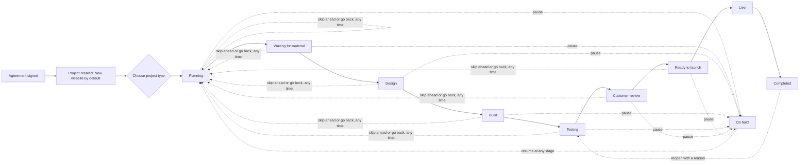
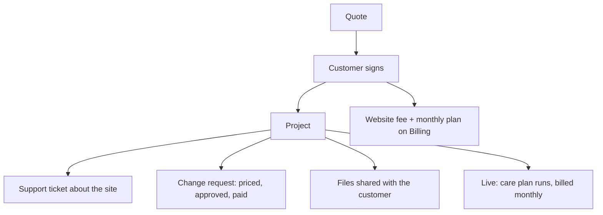

# How projects work

A **project** is the delivery side of a signed order: the work of building or looking after one customer's website. It is created automatically when a customer signs. Nothing about it is forced: every project can move to any stage, in any order.

## Why it is flexible
Real jobs differ. A Shopify storefront revamp has no brand-new design. A hosting move has no review. A customer can pause, or come back after launch. So:
- **Any stage can move to any other**, forwards, backwards or skipping steps. Skips are recorded.
- The only rule: **reopening a finished (Completed or Cancelled) project needs a reason.**
- **Project type** decides which steps show on the progress bar and which usual tasks are suggested. Changing the type never deletes anything.

| Type | Steps shown | Extra usual tasks |
|---|---|---|
| New website | Planning, Waiting for material, Design, Build, Testing, Customer review, Ready to launch, Live | none |
| Revamp an existing site (e.g. Shopify storefront) | same | review/back up the current site, redirects |
| Online shop | same | products, payments, test a real order |
| Hosting and move-over | Planning, Build, Testing, Ready to launch, Live | move files, backups, point the domain |
| Ongoing care only | Planning, Live | monitoring, backups, care plan |
| Something else | all | none |

## Flow

## What lives on a project
- **What to do now**: plain guidance for the current stage, and one button to add the usual tasks for it (never duplicated).
- **Checklist**: tick tasks off. Add your own.
- **What we need from the customer**: requests (logo, photos, copy). Mark received.
- **Files**: upload pictures, PDF, Word, Excel, zip, text. Team-only by default; share a file and the customer sees it in their portal. Optional folders.
- **Updates**: team-only notes, or updates the customer sees in their portal.
- **Tickets for this project**: anything raised about the site, including paid change requests.

## How it connects

