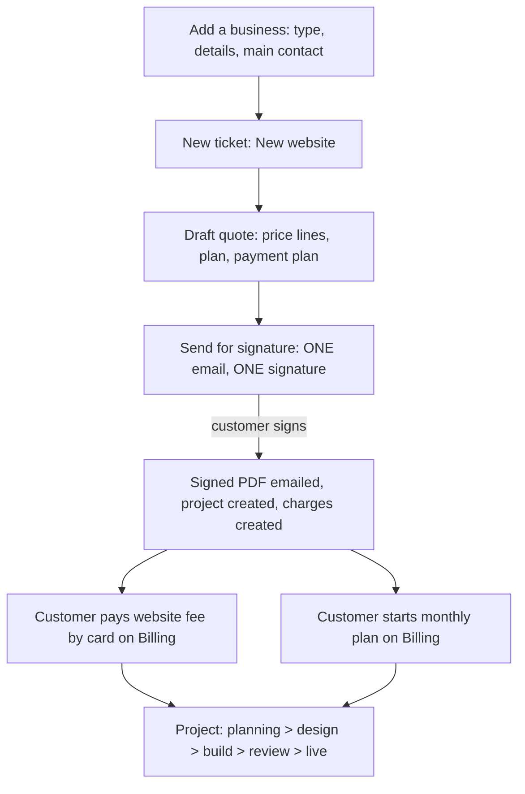
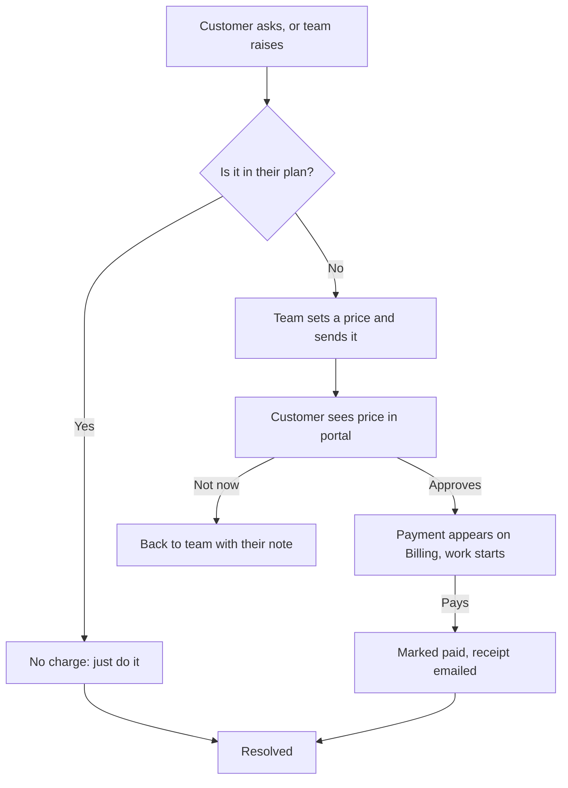
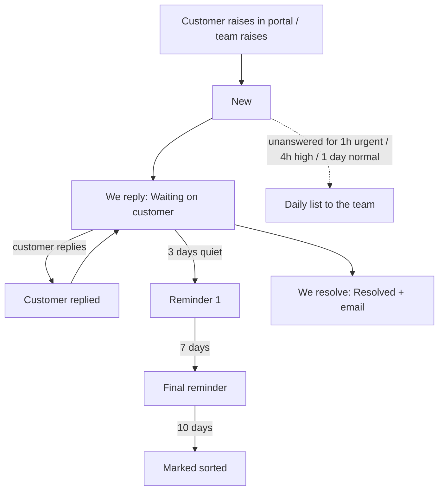

# How tickets, businesses and people work

## The three ideas
1. **Business** = a customer company (or sole trader / individual). Everything hangs off it.
2. **People** = the humans at that business. Each has a name, email and position. A person *may* also have a **portal login** at one of three levels.
3. **Ticket** = one piece of work or one conversation, always linked to a business and (if known) the person who got in touch.

## Three kinds of ticket (they are treated differently)
| Kind | What it is | What happens |
|---|---|---|
| **New website** | A new customer / new site | Quote -> customer signs ONE agreement (order, plan, services agreement, SLA, hosting) -> payments set up -> project starts |
| **Change request** | Work outside their plan | We set a price (or "no charge") -> customer approves in the portal -> pays by card -> we do it |
| **Support** | Something broken or a question, covered by their plan | We reply, fix, mark resolved |

## Statuses (same words everywhere)
New · In progress · **Customer replied** · **Waiting on customer** · Resolved · Closed.
Customer writes = *Customer replied*. We reply = *Waiting on customer*. Customers see these as "We've got it / We're on it / Waiting for you / Sorted".

## Flow: new business to live site

## Flow: change request

## Flow: support ticket and reminders

## Who can do what in the client portal
| | Owner | Team member | View only |
|---|---|---|---|
| See projects and documents | yes | yes | yes |
| Raise and reply to tickets | yes | yes | no |
| See and pay invoices, approve costs | yes | only with the billing switch | only with the billing switch |
| See who has access, ask for another person | yes | no | no |

Team controls (Business > People): invite, resend, change level, send password reset, remove access (signs them out), remove the person.
A client owner can ask for a new person; the team approves (can change the level) or declines, and the requester is emailed.

## Emails
Customer: ticket received · team reply · sorted · waiting reminders · change priced (approve) · payment received · plan live · payment failed · portal invitation · access request answered.
Team: new ticket / customer reply · customers waiting list · change approved/declined · payment events · access request.
